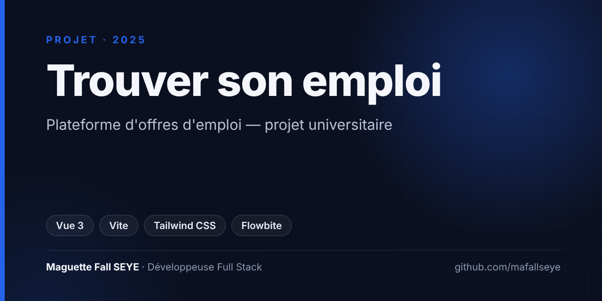

<p align="center"></p>

# Trouver son emploi

Plateforme d'offres d'emploi (projet universitaire).

**Démo en ligne :** https://trouversonemploi.netlify.app/

## Aperçu

<p align="center"><br><em>Page d'accueil</em></p>

## Fonctionnalités

- Consultation des offres d'emploi
- Interface responsive en Tailwind CSS et Flowbite
- Déploiement sur Netlify

## Technologies

Vue 3 · Vite · Tailwind CSS · Flowbite

## Lancer le projet

Prérequis : Node.js 18 ou plus.

```bash
git clone https://github.com/mafallseye/Trouversonemploi.com.git
cd Trouversonemploi.com
npm install
npm run dev
```

## Auteure

**Maguette Fall SEYE** — Développeuse Full Stack, Dakar (Sénégal) · [github.com/mafallseye](https://github.com/mafallseye)
